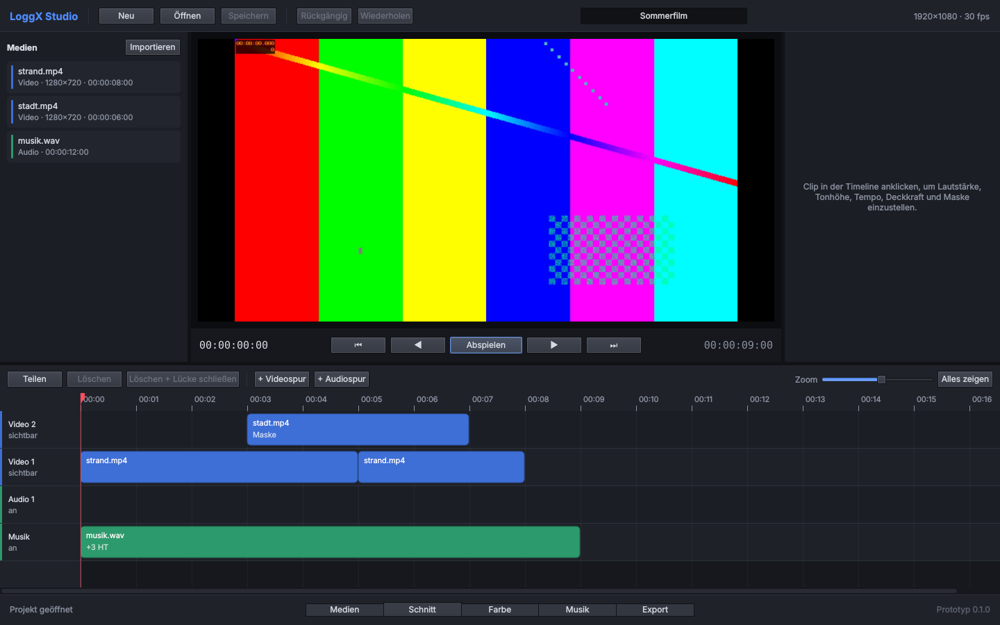
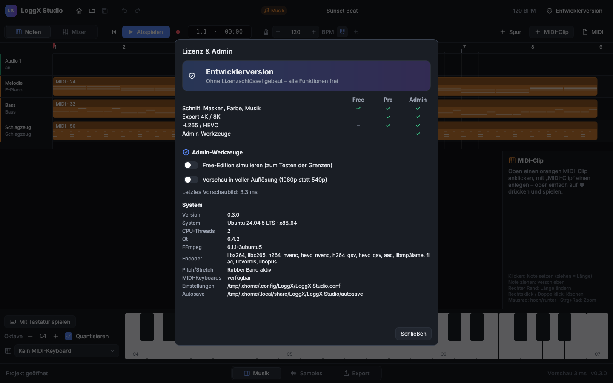

# LXStudio

Videoschnitt, Musikbearbeitung und Auflegen in einem Programm – für macOS und Windows 11 (Linux läuft ebenfalls). (Bis 0.6 hieß das Programm „LoggX Studio“; Projekte, Einstellungen und die DJ-Bibliothek bleiben erhalten.)

Dieses Repository enthält die **MVP-Vorschau 0.14**: KI-Freistellung, AV1-Videos, Performance-Pads wie bei rekordbox (Pad FX, Stems am FLX4), HDR-Export (HLG), Masken-Tracking, Mastering-Assistent, Auto-Update; DJ als eigener Modus mit **Pioneer DDJ-FLX4** und MIDI-Learn, Sampler, Key Shift/Key Sync, neue Tempo-Erkennung, Einstellungen, Rechtsklick-Menüs, außerdem Startbildschirm, neues Design, Video- **und reine Musikprojekte**, Übergänge, Beat-Erkennung, Aufnahme per Tastatur oder MIDI-Keyboard, Audio-/Stem-/MIDI-Export und ein Lizenzsystem mit Admin-Bereich. Fertig ist das Produkt noch nicht (siehe „Was noch fehlt“).





## Funktionen

**DJ** (eigener Modus: oben „Studio | DJ“ oder Strg+Tab – gleiche App, Tracks lassen sich direkt im Musik-Editor öffnen)
- **Zwei Decks** und Mixer: farbige Wellenformen (Übersicht und mitlaufend mit Beat-Raster), BPM und Tonart (Camelot, z. B. 8A), Tempo-Fader ±6/8/10/16/25/50 % (oben = langsamer wie am CDJ), **Master Tempo** (Tonhöhe bleibt), **SYNC** (Tempo und Takt, auch halbe/doppelte Tempi), Master-Deck, Takt-Anzeige und „Takte bis zum nächsten Cue“
- CUE wie am CDJ, Jog-Rad (Maus: festhalten = **Scratchen**), **8 Hot Cues** (werden pro Track gespeichert), **Loops** (½–32 Schläge, Loop In/Out, Reloop), Beat-Sprünge, Quantisieren
- **Beatgrid von Hand**: TAP-Tempo, ×2 / ÷2, Tempo eingeben (z. B. 143,75), Raster verschieben (±10 ms), „Schlag 1 hier“ – Handarbeit wird von keiner Analyse überschrieben
- Mixer: Trim, 3-Band-EQ mit Kill, Filter (Tief-/Hochpass), Kanalfader, Pegel, **Crossfader**, Master, **Kopfhörer** (CUE je Kanal vor dem Fader, Mix Cue↔Master, Pegel) – über Kanäle 3/4 des Controllers oder ein eigenes Ausgabegerät
- **Effekte**: Echo und Hall (im Takt), Bremse (Vinyl-Stopp) – auf Deck 1, 2 oder Master
- **Sampler** mit 8 Plätzen: eingebaute Klänge (Air Horn, Sirene, Riser, Downlifter, Laser, Sub Drop, Clap, Scratch – synthetisch erzeugt, rechtefrei) oder eigene Dateien (Rechtsklick oder Datei auf den Platz ziehen), eigener Pegel
- **Key Shift** (±12 Halbtöne, Tempo bleibt) und **Key Sync** (Tonart ans andere Deck anpassen); das Deck zeigt die klingende Tonart (z. B. 7B → 9B)
- **Wellenform-Zoom** (Mausrad, Strg+Plus/Minus, Shift+Browse am Controller)
- **Tastatur ohne Controller**: Deck 1 – A Cue, S Play, D Sync, Q/W Bend, 1–4 Hot Cues; Deck 2 – J Cue, K Play, L Sync, O/P Bend, 7–0 Hot Cues
- **Stems** pro Track: **eingebaute Stem-Engine** (sofort, ohne Download: Gesang über das Stereobild, Schlagzeug/Tonales per HPSS, Bass = tonal unter ~120 Hz) oder **KI** (MDX-Net, deutlich sauberer) – wählbar unter Einstellungen → DJ
- **Phrasen-Anzeige** wie in rekordbox unter der Übersicht: Intro, Up (Aufbau), Chorus (Drop), Down (Breakdown), Outro – 8-Takt-Abschnitte nach Energie und Bass
- **10 Beat-FX**: Echo, Hall, Bremse, Ping-Pong, Flanger, Phaser, Trans (Zerhacker im Raster), Roll, Filter (LFO), Rauschen
- **Quellen**: Google Drive, iCloud Drive, OneDrive, Dropbox (über deren Desktop-Apps, Sync-Ordner werden automatisch gefunden), Musik, Downloads und eigene Ordner (USB, NAS) direkt durchsuchen und laden
- Tracks aus der Liste oder direkt aus Explorer/Finder auf ein Deck ziehen
- **KI-Stems** pro Track: Gesang, Instrumente, Bass, Schlagzeug einzeln stummschalten (drei MDX-Net-Modelle, einmalig ~90 MB)
- **Bibliothek wie in rekordbox**: Sammlung, **Verlauf** (History, als Playlist sicherbar), **Playlists** (anlegen, umbenennen, Tracks hineinziehen), Spalten Titel/Interpret/Genre/BPM/Tonart/Zeit/Bewertung/Hinzugefügt, Suche, Sortierung, Pfeiltasten + Enter/←/→ zum Laden
- **Bibliothek anpassen**: Trenner zwischen Decks und Liste ziehen (größer/kleiner), Doppelklick oder „Groß“ (Strg+B) = Bibliothek groß mit kompakten Decks oben; Spalten ein-/ausblenden (Rechtsklick auf die Spaltenköpfe: Interpret, Album, Genre, BPM, Tonart, Zeit, Bewertung, Gespielt, Kommentar, Neu) und Zeilenhöhe – alles wird gemerkt
- **rekordbox übernehmen** (XML-Export: Tracks, BPM/Beatgrid, Tonart, Hot Cues, Bewertung, Playlists) und **Apple Music/iTunes** (Library.xml: Tracks, Bewertung, Playlists)
- Rechtsklick auf einen Track: laden, im Musik-Editor öffnen, Playlists, Tempo (eingeben, ×2, ÷2, neu analysieren), Bewertung, **online suchen** bei Beatport, SoundCloud, Spotify, Apple Music, TIDAL, YouTube, KI-Stems, im Ordner zeigen
- **Mix aufnehmen** als WAV und auf Wunsch ins Projekt übernehmen

**DJ-Controller**
- **Pioneer DDJ-FLX4** wird beim Einstecken automatisch erkannt (USB, ohne Einrichtung): Play/Cue, Shift+Cue (Anfang), Sync / Shift+Sync (Sync dauerhaft), Tempo-Fader (14 Bit), Tempo-Bereich, Jog-Räder (oben berührt = Scratchen, Rand = Pitch-Bend, Shift = schnell suchen), Kanalfader, Trim, 3-Band-EQ, CFX/Filter, Crossfader, Kopfhörer-CUE und -Mix, Browse-Regler + LOAD, Loop In/Out/Reloop, 4-Beat-Loop, Cue/Loop-Call (Loop halbieren/verdoppeln bzw. Beat-Sprung), Quantize
- Pads wie in rekordbox: Hot Cue (Shift = löschen), **Pad FX 1 und 2** (Shift + PAD FX; 16 Effekte, solange gedrückt – Slip Loop, Hall, Echo, Flanger, V.Brake, Trans, Crush, Filter LFO, Backspin …, frei belegbar), Beat Jump (±1–8), Beat Loop (¼–32), **Sampler** (Shift = stoppen), **Key Shift** (1 = zurück, 2–4 = +1…+3, 5 = Key Sync, 6–8 = −1…−3); Shift+Browse = Wellenform-Zoom; Beat FX: an/aus, Auswahl, Länge, Level/Depth, Kanal
- **Stems am FLX4** (Einstellungen → Controller): standardmäßig im Keyboard-Modus (Shift + HOT CUE) – Pads 1–4 Gesang/Schlagzeug/Bass/Instrumente an/aus, Pads 5–8 gedrückt halten = nur dieser Stem; wahlweise auf Beat Loop oder Sampler. Der **CFX-Regler** kann statt Filter die Stems steuern: links Acapella, rechts Instrumental
- In der App: Pad-Modus-Menü am Deck (HOT CUE, PAD FX mit Seite 1/2 und Zahnrad zum Belegen, BEAT JUMP, BEAT LOOP, KEY SHIFT, SAMPLER, STEMS) – folgt dem Modus am FLX4; Phrasen nummeriert (INTRO 1, UP 2, CHORUS 1 …)
- **LEDs** (Play, Cue blinkt wie am CDJ, Sync, CUE, Loop, Hot-Cue-Pads, Loop-Pads, Stems, Pegelanzeigen) und Keep-alive wie von rekordbox
- **Kopfhörer am FLX4**: Einstellungen → Audio → Ausgang „DDJ-FLX4“, Kopfhörer „Kanäle 3/4“
- **Andere Controller**: verbinden und per **MIDI-Learn** Tasten/Regler zuordnen (Einstellungen → Controller)
- Die MIDI-Nummern des FLX4 stammen aus der Zuordnung des freien DJ-Programms Mixxx (eigene Umsetzung, kein Mixxx-Code). Ohne echtes Gerät getestet: per Simulation der Nachrichten in den automatischen Tests. Unter Windows kann ein MIDI-Gerät nur von einem Programm gleichzeitig benutzt werden – rekordbox vorher schließen.

**Einstellungen** (Zahnrad oben rechts, Strg+,):
- Allgemein: beim Start öffnen (Startbildschirm, letztes Projekt, DJ-Modus), automatische Sicherung (aus/1–10 min), Vorschauqualität, „Zuletzt geöffnet“ leeren
- Audio: DJ-Ausgang, Kopfhörer (Kanäle 3/4 oder eigenes Gerät), Puffer, Mikrofon
- DJ: BPM-Bereich der Erkennung wie in rekordbox, Standard-Tempobereich, Key Lock beim Laden, Quantize, **Lautheit angleichen (Auto-Gain)**, spielendes Deck sperren, **KI-Stems automatisch beim Laden**, Wellenform-Farben (3-Band, Blau, einfarbig), Zoom
- Controller: Gerät, Tempo-Fader umkehren, MIDI-Learn
- Bibliothek: rekordbox/iTunes übernehmen, Verlauf leeren
- KI: Standard-Methode, **Modelle automatisch im Hintergrund laden**, Modell-Liste mit Status/Größe, alle laden, einzeln löschen, Ordner öffnen

**Video-Export**: H.264, H.265, **Apple ProRes 422 HQ** und **ProRes 4444** (mit Alpha, MOV, Ton als PCM), bis **8K** (Pro-Edition).

**macOS**: Die Mac-Version wird bei jedem Build als **LXStudio-<version>-macOS.dmg** gebaut (Apple Silicon). Ohne Apple-Entwicklerkonto ist sie nur ad-hoc signiert: beim ersten Start Rechtsklick → „Öffnen“.

**Streaming**: Spotify, Apple Music, SoundCloud und Beatport geben ihre Streams nur an DJ-Programme mit eigenem Partnervertrag frei (so wie bei rekordbox, Serato oder djay). Ohne diese Verträge kann LXStudio sie nicht abspielen; es gibt die Suche bei diesen Diensten per Rechtsklick und den Import gekaufter Dateien bzw. der Apple-Music-Library (nur lokale Dateien).

**Start und Projekte**
- Startbildschirm mit Vorlagen: Videoprojekt (Full HD, 4K, Hochkant 9:16, Quadrat, 24/60 fps) oder **Musikprojekt** (Beat 120, Dance 128, Hip-Hop 90, Ballade 72 BPM), zuletzt geöffnete Projekte
- **Musikprojekte** zeigen nur Musik, Samples und Export – ganz ohne Video
- Neues dunkles Design (eigener Qt-Quick-Stil mit Vektor-Symbolen), farbige Spuren, Takt-Lineal
- **Dateien hineinziehen** aus Explorer/Finder: auf die Timeline (an die Stelle unter der Maus), auf die Vorschau (am Abspielkopf), in die Medienliste (nur importieren); `.loggx` öffnet das Projekt, `.mid` importiert Noten
- **Rechtsklick** auf Clips (ausschneiden, kopieren, hier einfügen/teilen, duplizieren, Tempo/Tonart, an Projekt-Tempo anpassen, Gesang entfernen, löschen), auf Spurköpfe (umbenennen, stumm/solo, Instrument, verschieben, neue Spur, **Spur samt Inhalt löschen** – mit Undo) und auf leere Flächen
- **Projekteinstellungen** (Schieberegler-Knopf oben, Strg+Umschalt+,): Auflösung bis 8K oder eigene Größe, Bildrate 23,976 / 24 / 25 / 29,97 / 30 / 48 / 50 / 59,94 / 60 / 100 / 120 fps, Tempo und Taktart – für jedes Projekt jederzeit änderbar

**Video**
- Import von Video, Audio und Bildern (alles, was FFmpeg liest)
- Timeline mit beliebig vielen Video-, Audio- und Instrumentspuren: verschieben, trimmen, teilen, löschen, Lücke schließen, Einrasten; Vorschaubilder und Wellenformen in den Clips
- Position, Größe und Drehung pro Clip (Bild-im-Bild), Deckkraft, Ein-/Ausblenden
- **Keyframes** für Position, Größe, Drehung, Deckkraft, Lautstärke und Weichzeichner (◇ im Inspector)
- **Masken** (Rechteck, Ellipse, weiche Kante, umkehrbar)
- **Effekte:** Weichzeichner, Greenscreen (Chroma Key mit Farbsaum-Entfernung), Vignette, Schärfen, Leuchten, Filmkorn, Sepia, Farbversatz, Verpixeln, Spiegeln (↔/↕), Negativ; fertige **Looks** (Retro-Film, Traum, Glitch, Knackig, Schwarzweiß)
- **Vorschau** in Fenstergröße (Auto), Voll, Halb oder Viertel; beim Abspielen passt Auto die Größe an, damit es flüssig bleibt
- **Kopieren/Einfügen/Duplizieren** von Clips (Strg+C / Strg+V / Strg+D), **Standbild** in voller Auflösung als PNG/JPEG
- **Titel** mit Schriftgröße, Farbe, Ausrichtung, Hintergrundbalken und Schatten
- **Übergänge** zwischen Clips (11): Überblenden, über Schwarz, über Weiß, Wischen, Wischen nach oben, Schieben, Schieben nach oben, Kreis, Zoom, Weich überblenden, Verpixeln – Bild und Ton werden überblendet
- **Schnitt auf Beat:** Clip auf jeden Schlag, jeden 2. Schlag, jeden Takt oder alle 2 Takte zerschneiden
- **Farbkorrektur** (Belichtung, Kontrast, Sättigung, Temperatur, Tönung, Schatten/Mitten/Lichter), **3D-LUTs** (.cube) mit Stärke, **Scopes** (Waveform, RGB-Parade, Histogramm)

**Musik**
- **Instrumentspuren** mit MIDI-Clips und **Piano-Roll** (Noten setzen, verschieben, Länge, Anschlag, Raster, Transponieren)
- Sieben eingebaute Instrumente: Klavier, E-Piano, Synthesizer, Bass, Fläche, Streicher, Schlagzeug (General-MIDI-Belegung)
- Tempo (BPM) und Takt, MIDI-Clips rasten am Takt ein; **Takt-Raster** in der Timeline (Clips rasten auf Schläge ein)
- **Tempo-Erkennung** aus einem Musik-Clip (BPM und erster Schlag, das Raster richtet sich danach aus)
- **Tonart und BPM** eines Songs erkennen und ändern: Tonart wählen (Tonhöhe ändert sich, Tempo bleibt), BPM eingeben oder ans Projekt-Tempo anpassen (Tempo ändert sich, Tonhöhe bleibt); Analyse wird im Projekt gespeichert
- **Stimme entfernen / isolieren mit KI** (Vocal Remover): ein neuronales Netz (MDX-Net, ONNX Runtime) trennt Gesang und Instrumental – auch bei Mono-Aufnahmen. Zwei Stufen: „beste Qualität“ (Kim Vocal 2, 67 MB) und „schnell“ (MDX-Net, 30 MB); das Modell wird beim ersten Mal geladen und per SHA-256 geprüft. Ergebnis: „Gesang“ und „Instrumental“ als WAV auf zwei neuen Spuren an derselben Stelle. Ohne KI geht es weiterhin sofort (Mitten-Trennung).
- **Song-Tempo** im Musikprojekt ändern (Noten und Audio ziehen mit) und **Song transponieren** (Halbton, Ganzton, Oktave; Schlagzeug bleibt)
- **Live spielen:** Computertastatur (A W S E D F T G Z H U J K, −/+ = Oktave), Klaviatur per Maus oder **MIDI-Keyboard** (RtMidi)
- **Aufnahme** (R) in einen MIDI-Clip, wahlweise auf Sechzehntel quantisiert – ein Undo-Schritt
- **Mikrofon-Aufnahme** (Gesang, Instrumente) als WAV direkt auf eine Audiospur, mit Pegelanzeige und Geräteauswahl
- **MIDI-Dateien** importieren und exportieren (Standard-MIDI, Typ 1, mit Tempo)
- Audio: Lautstärke, **Tonhöhe ±12 Halbtöne ohne Tempoänderung**, **Tempo 0,25×–4× ohne Tonhöhenänderung**
- **Mixer** mit Pegelanzeige, Fader, Panorama, Stumm/Solo, 3-Band-EQ, Kompressor, Echo und Hall pro Spur; Master mit Limiter (−1 dBFS)

**Projekt und Export**
- Export als H.264 oder **H.265** + AAC (MP4/MOV/MKV) bis **8K**, vier Qualitätsstufen, Vorlagen für YouTube, Instagram/TikTok und Archiv; Hardware-Encoder, wenn vorhanden
- **Nur Audio:** WAV/FLAC (16 oder 24 Bit), MP3 320 kbit/s, AAC/M4A, Ogg Vorbis, Opus – mit oder ohne Ausklang
- **Stems:** jede Spur als eigene WAV/FLAC-Datei
- **Lizenzen und Admin:** Free / Pro / Admin mit signierten Schlüsseln (Ed25519, offline prüfbar); Admin-Bereich mit Free-Simulation, Vorschau in voller Auflösung, Renderzeit und Systeminfos – siehe [license/README.md](license/README.md)
- Projektdateien `.loggx` (JSON, Version 2; Dateien des Prototyps lassen sich weiter öffnen), Undo/Redo ohne Grenze
- **Automatisches Sichern** jede Minute, Wiederherstellung nach einem Absturz
- **KI-Freistellung** (Inspector → Effekte): Person/Objekt wird erkannt, der Hintergrund wird durchsichtig – ohne Greenscreen; darunterliegende Videospur scheint durch. Modelle: U²-Net small (4,6 MB, in der Vollversion enthalten) oder U²-Net Personen (176 MB, beste Qualität, Download bei Bedarf), beide Apache-2.0; Regler „Kante“ weich ↔ hart. Findet das Modell kein Motiv, bleibt das Bild sichtbar
- **AV1-Videos** (z. B. YouTube-Downloads) werden über dav1d dekodiert; lässt sich ein Video-Codec nicht dekodieren, meldet der Import das, statt schwarz zu bleiben
- **HDR-Export (HLG)**: H.265 Main 10 oder ProRes, BT.2020, Transfer HLG (ARIB STD-B67); SDR-Weiß nach BT.2408 auf 75 % HLG – sieht auf HDR-Fernsehern, YouTube und iPhone richtig aus und auf normalen Bildschirmen weiterhin korrekt
- **Masken-Tracking**: Maske auf den Clip legen, Abspielkopf auf den Startpunkt, „Maske verfolgen“ – der Inhalt unter der Maske wird bis zum Clip-Ende verfolgt (Vorlagenvergleich, grob → fein, geglättet) und als Keyframes für die Maskenposition gesetzt; Maskenposition ist auch von Hand animierbar
- **Mastering-Assistent** beim Audio-Export: misst die Lautheit (LUFS nach ITU-R BS.1770 mit Gating), formt den Klang leicht (Rumpelfilter, Bass, Luft), bringt den Mix auf das Ziel (Streaming −14, Club −9, Podcast −16 LUFS) und begrenzt Spitzen mit einem Limiter (−1 dBFS, 5 ms Vorschau). „Lautheit messen“ zeigt den aktuellen Wert.
- **Automatische Updates:** LXStudio prüft beim Start (höchstens alle 6 Stunden) die GitHub-Releases, zeigt oben ein Update-Symbol und installiert auf Klick (Windows still über den Installer, macOS tauscht die App aus); Prüfsumme (SHA-256) wird kontrolliert. Abschaltbar unter Einstellungen → Allgemein → Updates.
- Kommandozeile: `loggx-render projekt.loggx ausgabe.mp4 [--size 1280x720] [--codec h265] [--quality 2]`

| Musik | Mixer |
| --- | --- |
|  |  |
| **Farbe** | **Export** |
|  |  |
| **Lizenz & Admin** | |
|  | |

## Was noch fehlt (laut Konzept)

| Phase | Inhalt |
| --- | --- |
| MVP (Rest) | GPU-Rendering (Metal / DirectX 12) – bis dahin rechnet alles auf der CPU; Online-Konten und Lizenzprüfung über einen Server |
| 1.0 | AV1-Export, HDR mit echtem HDR-Material (PQ, Farbkorrektur in HDR), VST3/AU/CLAP, Web-Admin-Dashboard (braucht einen Server) |
| Ausbau | Auto-Reframe, Marktplatz (braucht einen Server), Multicam, RAW |

Schon erledigt aus 1.0/Ausbau: ProRes 422 HQ/4444 und 8K-Export, HDR-Export (HLG), Masken-Tracking, KI-Freistellung, AV1-Import, Audio-Aufnahme, Beat-Sync im DJ-Modus, Stem-Separation (eingebaut und KI), Mastering-Assistent.

Bekannte Grenzen:

- Bilder werden auf der CPU berechnet (alle Kerne). Beim Abspielen verkleinert „Auto“ die Vorschau bei Bedarf; 4K-Material und viele Effekte können ruckeln. Angehalten ist die Vorschau so scharf wie das Fenster.
- Die Mikrofon-Aufnahme gleicht die Latenz des Audiogeräts noch nicht aus (bei großen Puffern liegt sie minimal zu spät). Ein 8K-Export ist langsam und braucht rund 4 GB Arbeitsspeicher.
- Die Tempo-Erkennung (spektraler Fluss, feine Rastersuche über den ganzen Track und den ganzen BPM-Bereich, Bereich wie rekordbox 70–180 BPM einstellbar) erwartet ein gleichmäßiges Tempo (keine Tempowechsel im Stück). Bei halb/doppelt erkannten Tempi hilft ×2 / ÷2, bei Live-Aufnahmen TAP.
- Die KI-Trennung rechnet auf der CPU: grob 0,3–1× Echtzeit je nach Rechner und Stufe (ein 3-Minuten-Song braucht also etwa 1–10 Minuten). GPU-Beschleunigung fehlt noch.
- **Lizenzen der KI-Modelle:** Die Vollversion (Release-Downloads) bringt die MDX-Net-Modelle von kuielab (Gesang „schnell“, Schlagzeug, Bass, MIT-Lizenz) und das Freistellungs-Modell U²-Net small (Apache-2.0) gleich mit. „Kim Vocal 2“ hat keine angegebene Lizenz und wird deshalb nicht mitgeliefert, sondern bei Bedarf aus dem öffentlichen Archiv von *Ultimate Vocal Remover* geladen – vor einem kommerziellen Vertrieb klären oder auf „schnell“ umstellen.
- DJ: Kopfhörer auf einem eigenen Gerät (statt Kanälen 3/4) läuft über eine zweite Audioausgabe und kann sich bei sehr langen Sets minimal verschieben. Ob Windows die Kanäle 3/4 des FLX4 anbietet, hängt vom Treiber ab (Pioneer-Treiber installieren); die Info-Zeile unter Einstellungen → Audio zeigt, was aktiv ist – sonst Kopfhörer über „Eigenes Gerät“.
- Ohne öffentlichen Schlüssel in `license/public_key.txt` baut man eine Entwicklerversion: alle Funktionen frei, Admin-Bereich sichtbar.
- Die Wiedergabe-Uhr läuft unabhängig vom Audiogerät. Bei sehr langen Durchläufen ohne Stopp kann der Ton minimal vom Bild wegdriften.
- Hall und Echo setzen nach einem Sprung in der Timeline neu an (kein Nachklang von der vorherigen Stelle).
- Drehungs-Metadaten (Hochkant-Videos vom Handy) werden noch nicht ausgewertet.
- Installer und DMG sind nicht signiert: Windows SmartScreen warnt („Weitere Informationen → Trotzdem ausführen“), macOS beim ersten Start Rechtsklick → Öffnen.

## Herunterladen

Jeder erfolgreiche Push auf `prototyp` oder `main` erzeugt automatisch ein **Release** auf GitHub (**Releases → neueste Version**, Tag `v<version>-build.<nr>`). Es enthält die Vollversion:

- `LXStudio-<version>-Windows-Setup.exe` – Installer (Startmenü, optional Desktop-Verknüpfung und `.loggx`-Zuordnung), inklusive KI-Modelle
- `LXStudio-<version>-Windows-portable.zip` – entpacken und `LoggX Studio.exe` starten, ohne Installation
- `LXStudio-<version>-macOS.dmg` – LXStudio in „Programme“ ziehen (Apple Silicon)

Die letzten 8 automatischen Builds bleiben erhalten. Installierte Versionen finden neue Releases selbst und aktualisieren sich auf Klick. Tags wie `v1.0.0` werden ebenfalls veröffentlicht.

## Bauen

Benötigt: CMake ≥ 3.21, C- und C++20-Compiler, Qt ≥ 6.4 (Quick, Quick Controls, Multimedia, Network), FFmpeg ≥ 6, optional Rubber Band ≥ 3 (für Pitch/Tempo), RtMidi (für MIDI-Keyboards) und die [ONNX Runtime](https://github.com/microsoft/onnxruntime/releases) 1.20 (für die KI-Trennung: das vorgebaute Paket entpacken und `-DLOGGX_ONNXRUNTIME_DIR=<Ordner>` angeben). Monocypher (Lizenzsignaturen) und pocketfft (FFT) liegen in `third_party/`.

### macOS

```sh
brew install cmake ninja pkg-config qt ffmpeg rubberband nlohmann-json rtmidi
cmake -S . -B build -G Ninja -DCMAKE_PREFIX_PATH="$(brew --prefix qt)"
cmake --build build
open "build/app/LoggX Studio.app"
```

### Windows 11

Visual Studio 2022 (C++), Qt 6 (Online-Installer, mit „Qt Multimedia“) und vcpkg:

```powershell
vcpkg install "ffmpeg[core,avcodec,avformat,swscale,swresample,mp3lame,opus,vorbis]:x64-windows" rubberband:x64-windows nlohmann-json:x64-windows rtmidi:x64-windows
cmake -S . -B build -A x64 -DCMAKE_TOOLCHAIN_FILE=C:\vcpkg\scripts\buildsystems\vcpkg.cmake -DCMAKE_PREFIX_PATH=C:\Qt\6.7.3\msvc2019_64
cmake --build build --config Release
C:\Qt\6.7.3\msvc2019_64\bin\windeployqt.exe --qmldir app\qml "build\app\Release\LoggX Studio.exe"
```

Das komplette Paket (Installer + ZIP) baut `installer\windows\package.ps1` (benötigt [Inno Setup 6](https://jrsoftware.org/isinfo.php) für den Installer).

### Linux (Ubuntu 24.04)

Paketliste siehe `.github/workflows/build.yml`, danach:

```sh
cmake -S . -B build -G Ninja && cmake --build build
"./build/app/LoggX Studio"
```

### Tests

```sh
QT_QPA_PLATFORM=offscreen ctest --test-dir build --output-on-failure
```

## Bedienung

| Aktion | Taste |
| --- | --- |
| Abspielen / Pause | Leertaste |
| Startbildschirm | Strg+Pos1 |
| Aufnahme starten / stoppen (Musik) | R |
| Noten spielen (wenn „Mit Tastatur spielen“ an ist) | A W S E D F T G Z H U J K O L, −/+ = Oktave |
| Am Abspielkopf teilen | S oder Strg+B (in Musikprojekten nur Strg+B) |
| Clip löschen / mit Lücke schließen | Entf / Umschalt+Entf |
| Ein Bild zurück / vor | ← / → |
| Titel einfügen | T |
| MIDI-Clip anlegen | Strg+M |
| Rückgängig / Wiederholen | Strg+Z / Strg+Umschalt+Z |
| Clip kopieren / einfügen / duplizieren | Strg+C / Strg+V / Strg+D |
| Einstellungen / Projekteinstellungen | Strg+, / Strg+Umschalt+, |
| Studio ↔ DJ | Strg+Tab |
| Clip ausschneiden | Strg+X |
| DJ-Bibliothek: Auswahl / laden in Deck 1, 2 | ↑ ↓ / ← → (Enter = freies Deck) |
| Medien importieren | Strg+I |
| Timeline zoomen | Strg + Mausrad |

Doppelklick auf eine Datei in der Medienliste legt sie am Abspielkopf in die Timeline. ◇ neben einem Regler setzt einen Keyframe am Abspielkopf; sobald ein Parameter Keyframes hat, setzt jede Reglerbewegung automatisch einen Keyframe. In der Piano-Roll: Klick setzt eine Note (ziehen = Länge), Rechtsklick löscht. Ein Klick auf den Spurkopf schaltet die Spur stumm bzw. unsichtbar, ein Rechtsklick öffnet das Spurmenü (umbenennen, löschen …). Doppelklick auf die Beschriftung eines Reglers setzt ihn zurück.

## Lizenzen der Abhängigkeiten

Vor einer Veröffentlichung zu klären: Qt (LGPL oder kommerziell), FFmpeg (LGPL; Builds mit libx264 sind GPL), Rubber Band (GPL oder kommerziell), H.264/AAC-Patentlizenzen. Für dieses Repository ist noch keine eigene Lizenz festgelegt.
