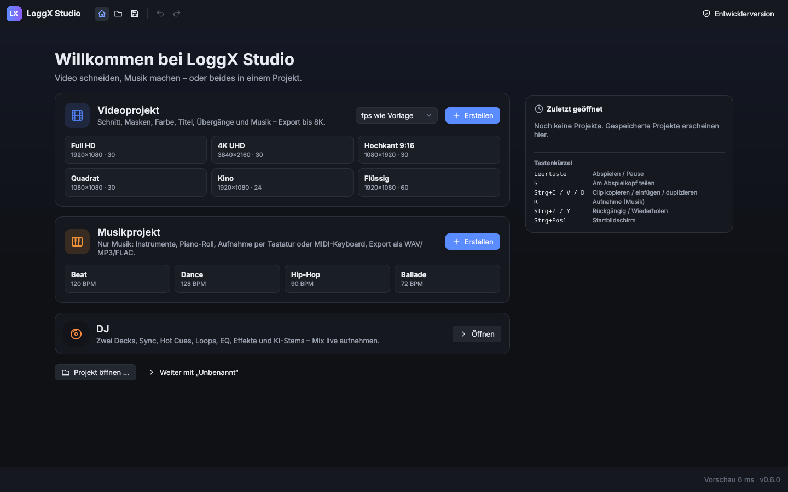
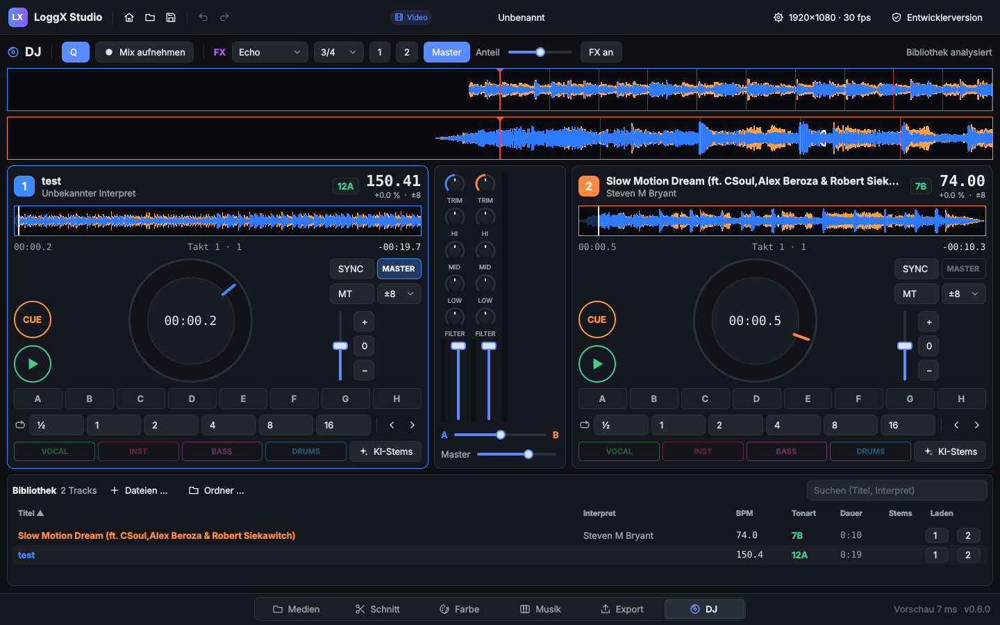
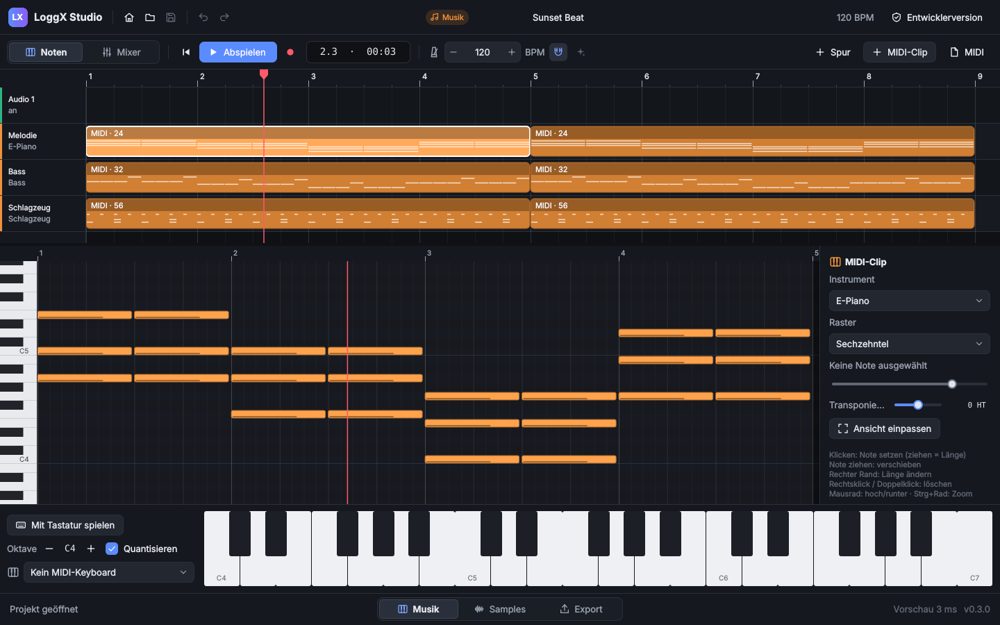
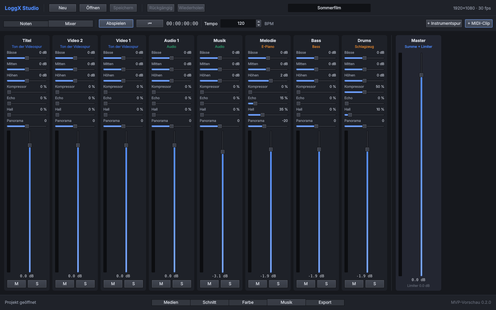
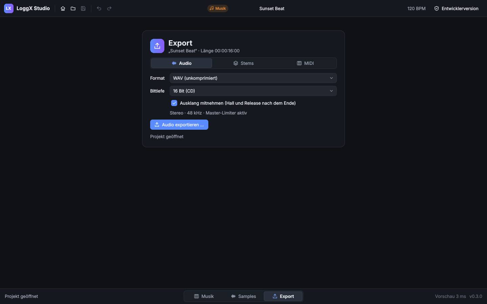

# LoggX Studio

Videoschnitt und Musikbearbeitung in einem Programm – für macOS und Windows 11 (Linux läuft ebenfalls).

Dieses Repository enthält die **MVP-Vorschau 0.6**: Startbildschirm, neues Design, Video- **und reine Musikprojekte**, Übergänge, Beat-Erkennung, Aufnahme per Tastatur oder MIDI-Keyboard, Audio-/Stem-/MIDI-Export und ein Lizenzsystem mit Admin-Bereich. Fertig ist das Produkt noch nicht (siehe „Was noch fehlt“).






## Funktionen

**DJ**
- Eigener Arbeitsbereich mit **zwei Decks** und Mixer: farbige Wellenformen (Übersicht und mitlaufend mit Beat-Raster), BPM und Tonart (Camelot, z. B. 8A), Tempo-Fader ±8/16/50 %, **Master Tempo** (Tonhöhe bleibt), **SYNC** (Tempo und Takt, auch halbe/doppelte Tempi), Master-Deck
- CUE wie am CDJ, Jog-Rad, **8 Hot Cues**, **Loops** (½–16 Schläge), Beat-Sprünge, Quantisieren
- Mixer: Trim, 3-Band-EQ mit Kill, Filter (Tief-/Hochpass), Kanalfader, Pegel, **Crossfader**, Master
- **Effekte**: Echo und Hall (im Takt), Bremse (Vinyl-Stopp) – auf Deck 1, 2 oder Master
- **KI-Stems** pro Track: Gesang, Instrumente, Bass, Schlagzeug einzeln stummschalten (drei MDX-Net-Modelle, einmalig ~90 MB)
- **Bibliothek**: Dateien/Ordner hinzufügen oder hineinziehen, Titel/Interpret aus den Tags, BPM und Tonart automatisch, Suche, Sortierung, ziehen oder doppelklicken zum Laden
- **Mix aufnehmen** als WAV und auf Wunsch ins Projekt übernehmen

**Start und Projekte**
- Startbildschirm mit Vorlagen: Videoprojekt (Full HD, 4K, Hochkant 9:16, Quadrat, 24/60 fps) oder **Musikprojekt** (Beat 120, Dance 128, Hip-Hop 90, Ballade 72 BPM), zuletzt geöffnete Projekte
- **Musikprojekte** zeigen nur Musik, Samples und Export – ganz ohne Video
- Neues dunkles Design (eigener Qt-Quick-Stil mit Vektor-Symbolen), farbige Spuren, Takt-Lineal
- **Dateien hineinziehen** aus Explorer/Finder: auf die Timeline (an die Stelle unter der Maus), auf die Vorschau (am Abspielkopf), in die Medienliste (nur importieren); `.loggx` öffnet das Projekt, `.mid` importiert Noten
- **Projekteinstellungen** (Zahnrad oben rechts, Strg+,): Auflösung bis 8K oder eigene Größe, Bildrate 23,976 / 24 / 25 / 29,97 / 30 / 48 / 50 / 59,94 / 60 / 100 / 120 fps, Tempo und Taktart – für jedes Projekt jederzeit änderbar

**Video**
- Import von Video, Audio und Bildern (alles, was FFmpeg liest)
- Timeline mit beliebig vielen Video-, Audio- und Instrumentspuren: verschieben, trimmen, teilen, löschen, Lücke schließen, Einrasten; Vorschaubilder und Wellenformen in den Clips
- Position, Größe und Drehung pro Clip (Bild-im-Bild), Deckkraft, Ein-/Ausblenden
- **Keyframes** für Position, Größe, Drehung, Deckkraft, Lautstärke und Weichzeichner (◇ im Inspector)
- **Masken** (Rechteck, Ellipse, weiche Kante, umkehrbar)
- **Effekte:** Weichzeichner, Greenscreen (Chroma Key mit Farbsaum-Entfernung), Vignette, Schärfen, Leuchten, Filmkorn, Sepia, Farbversatz, Verpixeln, Spiegeln (↔/↕), Negativ; fertige **Looks** (Retro-Film, Traum, Glitch, Knackig, Schwarzweiß)
- **Vorschau** in Fenstergröße (Auto), Voll, Halb oder Viertel; beim Abspielen passt Auto die Größe an, damit es flüssig bleibt
- **Kopieren/Einfügen/Duplizieren** von Clips (Strg+C / Strg+V / Strg+D), **Standbild** in voller Auflösung als PNG/JPEG
- **Titel** mit Schriftgröße, Farbe, Ausrichtung, Hintergrundbalken und Schatten
- **Übergänge** zwischen Clips (11): Überblenden, über Schwarz, über Weiß, Wischen, Wischen nach oben, Schieben, Schieben nach oben, Kreis, Zoom, Weich überblenden, Verpixeln – Bild und Ton werden überblendet
- **Schnitt auf Beat:** Clip auf jeden Schlag, jeden 2. Schlag, jeden Takt oder alle 2 Takte zerschneiden
- **Farbkorrektur** (Belichtung, Kontrast, Sättigung, Temperatur, Tönung, Schatten/Mitten/Lichter), **3D-LUTs** (.cube) mit Stärke, **Scopes** (Waveform, RGB-Parade, Histogramm)

**Musik**
- **Instrumentspuren** mit MIDI-Clips und **Piano-Roll** (Noten setzen, verschieben, Länge, Anschlag, Raster, Transponieren)
- Sieben eingebaute Instrumente: Klavier, E-Piano, Synthesizer, Bass, Fläche, Streicher, Schlagzeug (General-MIDI-Belegung)
- Tempo (BPM) und Takt, MIDI-Clips rasten am Takt ein; **Takt-Raster** in der Timeline (Clips rasten auf Schläge ein)
- **Tempo-Erkennung** aus einem Musik-Clip (BPM und erster Schlag, das Raster richtet sich danach aus)
- **Tonart und BPM** eines Songs erkennen und ändern: Tonart wählen (Tonhöhe ändert sich, Tempo bleibt), BPM eingeben oder ans Projekt-Tempo anpassen (Tempo ändert sich, Tonhöhe bleibt); Analyse wird im Projekt gespeichert
- **Stimme entfernen / isolieren mit KI** (Vocal Remover): ein neuronales Netz (MDX-Net, ONNX Runtime) trennt Gesang und Instrumental – auch bei Mono-Aufnahmen. Zwei Stufen: „beste Qualität“ (Kim Vocal 2, 67 MB) und „schnell“ (MDX-Net, 30 MB); das Modell wird beim ersten Mal geladen und per SHA-256 geprüft. Ergebnis: „Gesang“ und „Instrumental“ als WAV auf zwei neuen Spuren an derselben Stelle. Ohne KI geht es weiterhin sofort (Mitten-Trennung).
- **Song-Tempo** im Musikprojekt ändern (Noten und Audio ziehen mit) und **Song transponieren** (Halbton, Ganzton, Oktave; Schlagzeug bleibt)
- **Live spielen:** Computertastatur (A W S E D F T G Z H U J K, −/+ = Oktave), Klaviatur per Maus oder **MIDI-Keyboard** (RtMidi)
- **Aufnahme** (R) in einen MIDI-Clip, wahlweise auf Sechzehntel quantisiert – ein Undo-Schritt
- **Mikrofon-Aufnahme** (Gesang, Instrumente) als WAV direkt auf eine Audiospur, mit Pegelanzeige und Geräteauswahl
- **MIDI-Dateien** importieren und exportieren (Standard-MIDI, Typ 1, mit Tempo)
- Audio: Lautstärke, **Tonhöhe ±12 Halbtöne ohne Tempoänderung**, **Tempo 0,25×–4× ohne Tonhöhenänderung**
- **Mixer** mit Pegelanzeige, Fader, Panorama, Stumm/Solo, 3-Band-EQ, Kompressor, Echo und Hall pro Spur; Master mit Limiter (−1 dBFS)

**Projekt und Export**
- Export als H.264 oder **H.265** + AAC (MP4/MOV/MKV) bis **8K**, vier Qualitätsstufen, Vorlagen für YouTube, Instagram/TikTok und Archiv; Hardware-Encoder, wenn vorhanden
- **Nur Audio:** WAV/FLAC (16 oder 24 Bit), MP3 320 kbit/s, AAC/M4A, Ogg Vorbis, Opus – mit oder ohne Ausklang
- **Stems:** jede Spur als eigene WAV/FLAC-Datei
- **Lizenzen und Admin:** Free / Pro / Admin mit signierten Schlüsseln (Ed25519, offline prüfbar); Admin-Bereich mit Free-Simulation, Vorschau in voller Auflösung, Renderzeit und Systeminfos – siehe [license/README.md](license/README.md)
- Projektdateien `.loggx` (JSON, Version 2; Dateien des Prototyps lassen sich weiter öffnen), Undo/Redo ohne Grenze
- **Automatisches Sichern** jede Minute, Wiederherstellung nach einem Absturz
- Kommandozeile: `loggx-render projekt.loggx ausgabe.mp4 [--size 1280x720] [--codec h265] [--quality 2]`

| Musik | Mixer |
| --- | --- |
|  |  |
| **Farbe** | **Export** |
|  |  |
| **Lizenz & Admin** | |
|  | |

## Was noch fehlt (laut Konzept)

| Phase | Inhalt |
| --- | --- |
| MVP (Rest) | GPU-Rendering (Metal / DirectX 12) – bis dahin rechnet alles auf der CPU; Online-Konten und Lizenzprüfung über einen Server |
| 1.0 | ProRes, AV1, HDR, Masken-Tracking, KI-Freistellung, VST3/AU/CLAP, Audio-Aufnahme (Mikrofon), Web-Admin-Dashboard |
| Ausbau | Stem-Separation, Auto-Reframe, Mastering-Assistent, Marktplatz, Multicam, RAW |

Bekannte Grenzen:

- Bilder werden auf der CPU berechnet (alle Kerne). Beim Abspielen verkleinert „Auto“ die Vorschau bei Bedarf; 4K-Material und viele Effekte können ruckeln. Angehalten ist die Vorschau so scharf wie das Fenster.
- Die Mikrofon-Aufnahme gleicht die Latenz des Audiogeräts noch nicht aus (bei großen Puffern liegt sie minimal zu spät). Ein 8K-Export ist langsam und braucht rund 4 GB Arbeitsspeicher.
- Die Tempo-Erkennung erwartet ein gleichmäßiges Tempo (keine Tempowechsel im Stück).
- Die KI-Trennung rechnet auf der CPU: grob 0,3–1× Echtzeit je nach Rechner und Stufe (ein 3-Minuten-Song braucht also etwa 1–10 Minuten). GPU-Beschleunigung fehlt noch.
- **Lizenzen der KI-Modelle:** Die Modelle werden nicht mit dem Programm verteilt, sondern bei Bedarf aus dem öffentlichen Modell-Archiv von *Ultimate Vocal Remover* geladen. Die MDX-Net-Modelle von kuielab (Gesang „schnell“, Schlagzeug, Bass) stehen unter MIT-Lizenz; für „Kim Vocal 2“ ist keine Lizenz angegeben – vor einem kommerziellen Vertrieb klären oder auf „schnell“ umstellen.
- DJ: Vorhören über Kopfhörer (zweiter Audioausgang) und DJ-Controller (MIDI-Zuordnung) fehlen noch; Tempo- und Tonart-Erkennung erwarten ein gleichmäßiges Tempo.
- Ohne öffentlichen Schlüssel in `license/public_key.txt` baut man eine Entwicklerversion: alle Funktionen frei, Admin-Bereich sichtbar.
- Die Wiedergabe-Uhr läuft unabhängig vom Audiogerät. Bei sehr langen Durchläufen ohne Stopp kann der Ton minimal vom Bild wegdriften.
- Hall und Echo setzen nach einem Sprung in der Timeline neu an (kein Nachklang von der vorherigen Stelle).
- Drehungs-Metadaten (Hochkant-Videos vom Handy) werden noch nicht ausgewertet.
- Für macOS gibt es noch kein fertiges Paket; dort wird aus dem Quelltext gebaut.

## Herunterladen (Windows)

Jeder Push baut auf GitHub automatisch ein Windows-Paket: **Actions → Build → letzter Lauf → Artefakt „LoggX-Studio-Windows“**. Es enthält:

- `LoggX-Studio-<version>-Windows-Setup.exe` – Installer (Startmenü, optional Desktop-Verknüpfung und Zuordnung von `.loggx`-Dateien)
- `LoggX-Studio-<version>-Windows-portable.zip` – entpacken und `LoggX Studio.exe` starten, ohne Installation

Das Paket ist nicht signiert. Windows SmartScreen warnt deshalb beim ersten Start („Weitere Informationen → Trotzdem ausführen“).

Wird ein Tag wie `v0.1.0` gepusht, legt die CI die Dateien zusätzlich als (Vor-)Release an.

## Bauen

Benötigt: CMake ≥ 3.21, C- und C++20-Compiler, Qt ≥ 6.4 (Quick, Quick Controls, Multimedia, Network), FFmpeg ≥ 6, optional Rubber Band ≥ 3 (für Pitch/Tempo), RtMidi (für MIDI-Keyboards) und die [ONNX Runtime](https://github.com/microsoft/onnxruntime/releases) 1.20 (für die KI-Trennung: das vorgebaute Paket entpacken und `-DLOGGX_ONNXRUNTIME_DIR=<Ordner>` angeben). Monocypher (Lizenzsignaturen) und pocketfft (FFT) liegen in `third_party/`.

### macOS

```sh
brew install cmake ninja pkg-config qt ffmpeg rubberband nlohmann-json rtmidi
cmake -S . -B build -G Ninja -DCMAKE_PREFIX_PATH="$(brew --prefix qt)"
cmake --build build
open "build/app/LoggX Studio.app"
```

### Windows 11

Visual Studio 2022 (C++), Qt 6 (Online-Installer, mit „Qt Multimedia“) und vcpkg:

```powershell
vcpkg install "ffmpeg[core,avcodec,avformat,swscale,swresample,mp3lame,opus,vorbis]:x64-windows" rubberband:x64-windows nlohmann-json:x64-windows rtmidi:x64-windows
cmake -S . -B build -A x64 -DCMAKE_TOOLCHAIN_FILE=C:\vcpkg\scripts\buildsystems\vcpkg.cmake -DCMAKE_PREFIX_PATH=C:\Qt\6.7.3\msvc2019_64
cmake --build build --config Release
C:\Qt\6.7.3\msvc2019_64\bin\windeployqt.exe --qmldir app\qml "build\app\Release\LoggX Studio.exe"
```

Das komplette Paket (Installer + ZIP) baut `installer\windows\package.ps1` (benötigt [Inno Setup 6](https://jrsoftware.org/isinfo.php) für den Installer).

### Linux (Ubuntu 24.04)

Paketliste siehe `.github/workflows/build.yml`, danach:

```sh
cmake -S . -B build -G Ninja && cmake --build build
"./build/app/LoggX Studio"
```

### Tests

```sh
QT_QPA_PLATFORM=offscreen ctest --test-dir build --output-on-failure
```

## Bedienung

| Aktion | Taste |
| --- | --- |
| Abspielen / Pause | Leertaste |
| Startbildschirm | Strg+Pos1 |
| Aufnahme starten / stoppen (Musik) | R |
| Noten spielen (wenn „Mit Tastatur spielen“ an ist) | A W S E D F T G Z H U J K O L, −/+ = Oktave |
| Am Abspielkopf teilen | S oder Strg+B (in Musikprojekten nur Strg+B) |
| Clip löschen / mit Lücke schließen | Entf / Umschalt+Entf |
| Ein Bild zurück / vor | ← / → |
| Titel einfügen | T |
| MIDI-Clip anlegen | Strg+M |
| Rückgängig / Wiederholen | Strg+Z / Strg+Umschalt+Z |
| Clip kopieren / einfügen / duplizieren | Strg+C / Strg+V / Strg+D |
| Projekteinstellungen | Strg+, |
| Medien importieren | Strg+I |
| Timeline zoomen | Strg + Mausrad |

Doppelklick auf eine Datei in der Medienliste legt sie am Abspielkopf in die Timeline. ◇ neben einem Regler setzt einen Keyframe am Abspielkopf; sobald ein Parameter Keyframes hat, setzt jede Reglerbewegung automatisch einen Keyframe. In der Piano-Roll: Klick setzt eine Note (ziehen = Länge), Rechtsklick löscht. Ein Klick auf den Spurkopf schaltet die Spur stumm bzw. unsichtbar. Doppelklick auf die Beschriftung eines Reglers setzt ihn zurück.

## Lizenzen der Abhängigkeiten

Vor einer Veröffentlichung zu klären: Qt (LGPL oder kommerziell), FFmpeg (LGPL; Builds mit libx264 sind GPL), Rubber Band (GPL oder kommerziell), H.264/AAC-Patentlizenzen. Für dieses Repository ist noch keine eigene Lizenz festgelegt.
