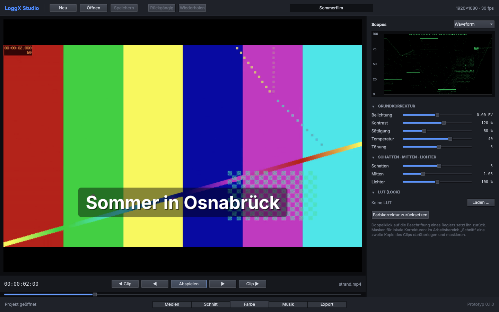

# LoggX Studio

Videoschnitt und Musikbearbeitung in einem Programm – für macOS und Windows 11 (Linux läuft ebenfalls).

Dieses Repository enthält die **MVP-Vorschau 0.2**: Schnitt, Farbe, Titel und eine eingebaute Musikproduktion mit Instrumenten und Mixer. Fertig ist das Produkt noch nicht (siehe „Was noch fehlt“).


## Funktionen

**Video**
- Import von Video, Audio und Bildern (alles, was FFmpeg liest)
- Timeline mit beliebig vielen Video-, Audio- und Instrumentspuren: verschieben, trimmen, teilen, löschen, Lücke schließen, Einrasten; Vorschaubilder und Wellenformen in den Clips
- Position, Größe und Drehung pro Clip (Bild-im-Bild), Deckkraft, Ein-/Ausblenden
- **Keyframes** für Position, Größe, Drehung, Deckkraft, Lautstärke und Weichzeichner (◇ im Inspector)
- **Masken** (Rechteck, Ellipse, weiche Kante, umkehrbar)
- **Effekte:** Weichzeichner, Greenscreen (Chroma Key mit Farbsaum-Entfernung), Vignette
- **Titel** mit Schriftgröße, Farbe, Ausrichtung, Hintergrundbalken und Schatten
- **Farbkorrektur** (Belichtung, Kontrast, Sättigung, Temperatur, Tönung, Schatten/Mitten/Lichter), **3D-LUTs** (.cube) mit Stärke, **Scopes** (Waveform, RGB-Parade, Histogramm)

**Musik**
- **Instrumentspuren** mit MIDI-Clips und **Piano-Roll** (Noten setzen, verschieben, Länge, Anschlag, Raster, Transponieren)
- Sieben eingebaute Instrumente: Klavier, E-Piano, Synthesizer, Bass, Fläche, Streicher, Schlagzeug (General-MIDI-Belegung)
- Tempo (BPM) und Takt, MIDI-Clips rasten am Takt ein
- Audio: Lautstärke, **Tonhöhe ±12 Halbtöne ohne Tempoänderung**, **Tempo 0,25×–4× ohne Tonhöhenänderung**
- **Mixer** mit Pegelanzeige, Fader, Panorama, Stumm/Solo, 3-Band-EQ, Kompressor, Echo und Hall pro Spur; Master mit Limiter (−1 dBFS)

**Projekt und Export**
- Export als H.264 oder **H.265** + AAC (MP4/MOV/MKV) bis **4K**, vier Qualitätsstufen, Vorlagen für YouTube, Instagram/TikTok und Archiv; Hardware-Encoder, wenn vorhanden
- Projektdateien `.loggx` (JSON, Version 2; Dateien des Prototyps lassen sich weiter öffnen), Undo/Redo ohne Grenze
- **Automatisches Sichern** jede Minute, Wiederherstellung nach einem Absturz
- Kommandozeile: `loggx-render projekt.loggx ausgabe.mp4 [--size 1280x720] [--codec h265] [--quality 2]`

| Farbe | Musik | Mixer |
| --- | --- | --- |
|  |  |  |

## Was noch fehlt (laut Konzept)

| Phase | Inhalt |
| --- | --- |
| MVP (Rest) | GPU-Rendering (Metal / DirectX 12), Übergänge zwischen Clips, Admin-Zugang und Lizenzsystem (braucht einen Server), MIDI-Keyboard-Eingabe, Beat-Erkennung |
| 1.0 | 8K, ProRes, AV1, HDR, Masken-Tracking, KI-Freistellung, VST3/AU/CLAP, Aufnahme, Beat-Sync, Web-Admin-Dashboard |
| Ausbau | Stem-Separation, Auto-Reframe, Mastering-Assistent, Marktplatz, Multicam, RAW |

Bekannte Grenzen:

- Bilder werden auf der CPU berechnet (alle Kerne). Die Vorschau wird deshalb auf höchstens 960×540 verkleinert; 4K-Material und viele Effekte können ruckeln, ein 4K-Export dauert.
- Die Wiedergabe-Uhr läuft unabhängig vom Audiogerät. Bei sehr langen Durchläufen ohne Stopp kann der Ton minimal vom Bild wegdriften.
- Hall und Echo setzen nach einem Sprung in der Timeline neu an (kein Nachklang von der vorherigen Stelle).
- Drehungs-Metadaten (Hochkant-Videos vom Handy) werden noch nicht ausgewertet.
- Für macOS gibt es noch kein fertiges Paket; dort wird aus dem Quelltext gebaut.

## Herunterladen (Windows)

Jeder Push baut auf GitHub automatisch ein Windows-Paket: **Actions → Build → letzter Lauf → Artefakt „LoggX-Studio-Windows“**. Es enthält:

- `LoggX-Studio-<version>-Windows-Setup.exe` – Installer (Startmenü, optional Desktop-Verknüpfung und Zuordnung von `.loggx`-Dateien)
- `LoggX-Studio-<version>-Windows-portable.zip` – entpacken und `LoggX Studio.exe` starten, ohne Installation

Das Paket ist nicht signiert. Windows SmartScreen warnt deshalb beim ersten Start („Weitere Informationen → Trotzdem ausführen“).

Wird ein Tag wie `v0.1.0` gepusht, legt die CI die Dateien zusätzlich als (Vor-)Release an.

## Bauen

Benötigt: CMake ≥ 3.21, C++20-Compiler, Qt ≥ 6.4 (Quick, Quick Controls, Multimedia), FFmpeg ≥ 6, optional Rubber Band ≥ 3 (für Pitch/Tempo).

### macOS

```sh
brew install cmake ninja pkg-config qt ffmpeg rubberband nlohmann-json
cmake -S . -B build -G Ninja -DCMAKE_PREFIX_PATH="$(brew --prefix qt)"
cmake --build build
open "build/app/LoggX Studio.app"
```

### Windows 11

Visual Studio 2022 (C++), Qt 6 (Online-Installer, mit „Qt Multimedia“) und vcpkg:

```powershell
vcpkg install "ffmpeg[core,avcodec,avformat,swscale,swresample]:x64-windows" rubberband:x64-windows nlohmann-json:x64-windows
cmake -S . -B build -A x64 -DCMAKE_TOOLCHAIN_FILE=C:\vcpkg\scripts\buildsystems\vcpkg.cmake -DCMAKE_PREFIX_PATH=C:\Qt\6.7.3\msvc2019_64
cmake --build build --config Release
C:\Qt\6.7.3\msvc2019_64\bin\windeployqt.exe --qmldir app\qml "build\app\Release\LoggX Studio.exe"
```

Das komplette Paket (Installer + ZIP) baut `installer\windows\package.ps1` (benötigt [Inno Setup 6](https://jrsoftware.org/isinfo.php) für den Installer).

### Linux (Ubuntu 24.04)

Paketliste siehe `.github/workflows/build.yml`, danach:

```sh
cmake -S . -B build -G Ninja && cmake --build build
"./build/app/LoggX Studio"
```

### Tests

```sh
QT_QPA_PLATFORM=offscreen ctest --test-dir build --output-on-failure
```

## Bedienung

| Aktion | Taste |
| --- | --- |
| Abspielen / Pause | Leertaste |
| Am Abspielkopf teilen | S oder Strg+B |
| Clip löschen / mit Lücke schließen | Entf / Umschalt+Entf |
| Ein Bild zurück / vor | ← / → |
| Titel einfügen | T |
| MIDI-Clip anlegen | Strg+M |
| Rückgängig / Wiederholen | Strg+Z / Strg+Umschalt+Z |
| Medien importieren | Strg+I |
| Timeline zoomen | Strg + Mausrad |

Doppelklick auf eine Datei in der Medienliste legt sie am Abspielkopf in die Timeline. ◇ neben einem Regler setzt einen Keyframe am Abspielkopf; sobald ein Parameter Keyframes hat, setzt jede Reglerbewegung automatisch einen Keyframe. In der Piano-Roll: Klick setzt eine Note (ziehen = Länge), Rechtsklick löscht. Ein Klick auf den Spurkopf schaltet die Spur stumm bzw. unsichtbar. Doppelklick auf die Beschriftung eines Reglers setzt ihn zurück.

## Lizenzen der Abhängigkeiten

Vor einer Veröffentlichung zu klären: Qt (LGPL oder kommerziell), FFmpeg (LGPL; Builds mit libx264 sind GPL), Rubber Band (GPL oder kommerziell), H.264/AAC-Patentlizenzen. Für dieses Repository ist noch keine eigene Lizenz festgelegt.
